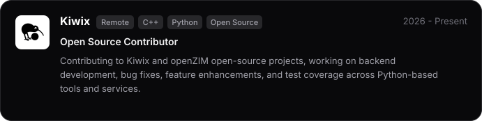

  
  <h1>Hi, I'm Sriram.</h1>
  
Full-stack developer building modern web applications, developer tools, and scalable systems.

 

## About

I'm Sriram, a <a href="https://github.com/Sriram-Nambiar">full-stack developer and open-source contributor</a> passionate about building web applications, developer tools, and reliable software. I contribute to projects under **Kiwix** and **openZIM**, working on bug fixes, feature development, backend improvements, and testing. I enjoy building with **Next.js**, **TypeScript**, and **Python**. Outside of coding, I enjoy solving algorithmic problems, exploring systems programming, and contributing to open-source software.

## Work Experience

<!--
====================================================================
Alternative: Standalone GitHub Markdown (No SVG file dependency)
If you prefer not to use an SVG file and want live GitHub/Shields icons:
====================================================================

<table>
  <tr>
    <td width="56" valign="top">
      
    </td>
    <td>
      <b>Kiwix</b> &nbsp;
      
      
      
      
       
      <b>Open Source Contributor</b>
      
Contributing to Kiwix and openZIM open-source projects, working on backend development, bug fixes, feature enhancements, and test coverage across Python-based tools and services.

    </td>
  </tr>
</table>
-->
